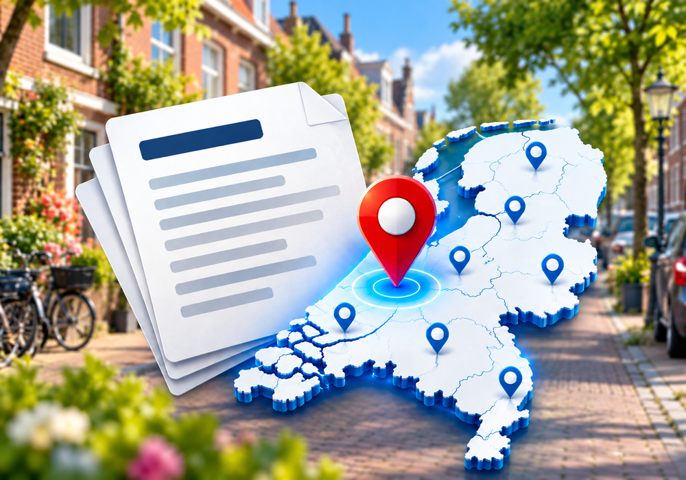

# Bekendmakingen NL voor Homey

  

**Bekendmakingen NL** is een Homey-app waarmee je officiële Nederlandse overheidspublicaties volgt voor een zelfgekozen adres of gebied. Ontvang via Homey informatie over nieuwe vergunningen, verkeersbesluiten, lokale regelgeving en andere bekendmakingen — zonder telkens zelf overheidssites te hoeven controleren.

De app gebruikt officiële publicatiegegevens van **KOOP** en locatiegegevens van **PDOK**.

## Wat doet de app?

- Controleert automatisch op nieuwe officiële bekendmakingen in het ingestelde zoekgebied.
- Zoekt naar **alle soorten officiële bekendmakingen**, niet alleen naar vergunningen.
- Vergelijkt nieuwe resultaten met eerder gevonden publicaties en houdt het aantal nieuwe berichten bij.
- Toont aantallen van **vandaag** en de **afgelopen 7 dagen**.
- Laat recente bekendmakingen zien met publicatiedatum, publicerende instantie en een link naar de officiële publicatie.
- Maakt het mogelijk om via **Homey Flows** op nieuwe bekendmakingen te reageren.
- Heeft een Flow-actie **'Nu controleren'** voor een onmiddellijke controle.

### Voorbeelden van bekendmakingen

- Bouw-, verbouw- en sloopvergunningen
- Kapvergunningen en besluiten over bomen
- Milieuvergunningen
- Evenementenvergunningen
- Verkeersbesluiten, zoals parkeermaatregelen
- Ruimtelijke plannen en besluiten
- Gemeentelijke regels en overige overheidspublicaties

*Welke publicaties verschijnen, hangt af van de officiële brongegevens en de ingestelde locatie.*

## Zoekgebieden

Je kunt op twee manieren zoeken:

| Zoekmethode | Werking |
|---|---|
| **Adres + straal** | Controleert bekendmakingen rond een gekozen adres binnen een ingestelde afstand. |
| **Dorp, stad, wijk, buurt of gemeente** | Gebruikt het gekozen geografische gebied, in plaats van een afstand rondom één middelpunt. |

Voor de locatiebepaling en geografische gegevens wordt **PDOK** gebruikt. De app combineert verschillende locatie- en publicatiegegevens om ook bredere, bijvoorbeeld gemeentebrede, bekendmakingen te kunnen vinden.

## Homey-apparaat

Op het apparaatscherm zie je onder andere:

| Onderdeel | Betekenis |
|---|---|
| **Nieuw** | Aantal nieuw gevonden bekendmakingen |
| **Vandaag** | Aantal bekendmakingen van vandaag |
| **Afgelopen 7 dagen** | Aantal bekendmakingen over de afgelopen week |
| **Status** | Informatie over de controle |
| **Laatste bekendmaking** | Meest recente gevonden publicatie |

Het berichtenoverzicht bevat aanvullende details en officiële publicatielinks.

## Homey Flows

De app heeft Flow-triggers voor verschillende soorten nieuwe bekendmakingen, waaronder:

- **Nieuwe bekendmaking**
- **Nieuwe vergunning gevonden**
- **Nieuwe verkeersbekendmaking**
- **Nieuwe kap- of boombekendmaking**
- **Nieuwe evenementenbekendmaking**
- **Nieuwe ruimtelijke bekendmaking**

Bij de Flow-triggers zijn informatie-tags beschikbaar waarmee je gegevens uit de bekendmaking in je automatisering kunt gebruiken.

**Actiekaart:** **Nu controleren** — start meteen een nieuwe controle voor het ingestelde apparaat, los van het automatische controle-interval.

**Let op:** een geslaagde uitvoering van de actie 'Nu controleren' betekent dat de actie is uitgevoerd, niet automatisch dat er nieuwe publicaties zijn gevonden. Raadpleeg de tellers, het overzicht of bijbehorende Flow-triggers voor resultaten.

## Instellingen

- Keuze tussen **adres + straal** en een **geografisch gebied**
- Instelbaar controle-interval (standaard **15 minuten**, minimaal **5 minuten**)
- Instelbaar aantal getoonde berichten: **1 t/m 50** (standaard **5**)
- Historie over de **afgelopen 7 dagen**; maximaal **50** opgeslagen berichten

Bij de eerste controle wordt een uitgangssituatie opgebouwd, zodat bestaande publicaties niet allemaal als nieuw worden gemeld.

## Aan de slag

1. Installeer **Bekendmakingen NL** op je Homey.
2. Voeg een **Bekendmakingen NL**-apparaat toe.
3. Kies je adres met straal of je gewenste dorp, stad, wijk, buurt of gemeente.
4. Stel het controle-interval en het aantal getoonde berichten in.
5. Bekijk gevonden bekendmakingen in het apparaat en maak optioneel Homey Flows aan voor meldingen en automatiseringen.

## Databronnen en aandachtspunten

- **KOOP**: officiële Nederlandse overheidspublicaties.
- **PDOK**: adressen en geografische gebiedsinformatie.
- De app toont links naar de **oorspronkelijke officiële publicaties**.
- Niet iedere publicatie bevat volledige of eenduidige locatiegegevens. Daardoor kunnen bepaalde publicaties ontbreken of moeilijk aan een specifiek zoekgebied te koppelen zijn.
- Ook bronlimieten en wijzigingen in openbare diensten kunnen de resultaten beïnvloeden. De volledigheid van alle geografische zoekmethoden is niet voor elke situatie live bevestigd.

**Bekendmakingen NL is een onafhankelijk Homey-project en geen officiële app van de Nederlandse overheid.**
